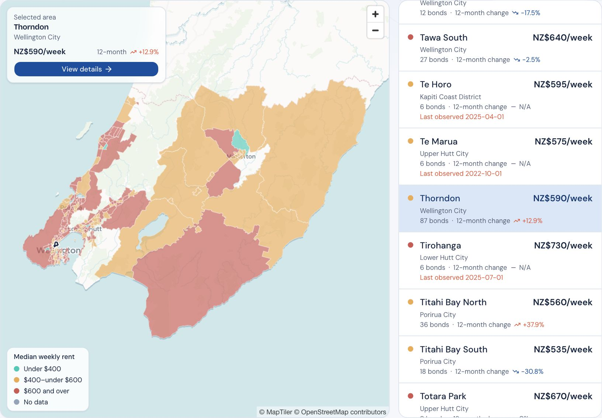

# RoostMap

RoostMap is an independently designed portfolio and learning project: a New Zealand rental-area evidence explorer. It uses official rental and statistical geography data to help renters understand observed weekly rents, historical changes and data coverage across SA2 areas.

RoostMap provides regional statistical evidence rather than live rental listings or a recommendation about the best place to live.

Live site: <https://victorious-island-0bcdf8f10.3.azurestaticapps.net>



## What you can do

- Explore the SA2 areas of any New Zealand Region on a map and in a list
- Filter by dwelling type and bedroom category; the map, list and area details use the same category
- Open an area to see its latest observed rent, Reported Bonds, 12-month change and quarterly rent history
- Share or reload a page and keep the selected Region, category and area, which are stored in the URL
- Check data periods, provisional status, sources, licences and known limitations on the Methodology page

## Technical highlights

- **Versioned static data release.** Node.js scripts read the MBIE CSV and the Stats NZ GeoPackage, keep only the published categories, join records on the SA2 2019 code and write one current-rents, boundary and rent-history file per Region, plus a manifest. `data/source-lock.json` records each source file's SHA-256, and the same inputs produce the same release.
- **Data contracts.** Zod schemas check the generated release in the pipeline tests and every file the browser loads, so a malformed file shows an error instead of wrong numbers.
- **Missing data stays missing.** Values that MBIE does not publish are shown as No data, never as zero, an estimate or a value from another category. Rent history breaks the line at missing quarters.
- **Shareable state.** The selected Region, category and area live in the URL, so a link reopens the same view. TanStack Query caches each Region file by its URL, so switching back to a recently viewed Region uses the cached data.
- **Tested delivery.** Vitest and React Testing Library cover the pipeline rules and page behaviour, and Playwright follows the core journey in a real browser. GitHub Actions run the checks, deploy every pull request to an Azure Static Web Apps preview and test it there, then deploy `main` to production and run the same tests.

## Tech stack

React 19, TypeScript (strict), Vite, React Router, TanStack Query, Zod, MapLibre GL JS with react-map-gl and MapTiler, Recharts, Tailwind CSS and shadcn/ui; Node.js data scripts; Vitest, React Testing Library and Playwright; GitHub Actions and Azure Static Web Apps.

## Data sources

- [MBIE Rental Bond Data](https://www.tenancy.govt.nz/about-tenancy-services/data-and-statistics/rental-bond-data/), licensed under Creative Commons Attribution 3.0 New Zealand
- [Stats NZ Statistical Area 2 Higher Geographies 2019 (generalised)](https://datafinder.stats.govt.nz/layer/98779-statistical-area-2-higher-geographies-2019-generalised/), licensed under Creative Commons Attribution 4.0 International

An area is published when its MBIE records include a rent and its SA2 code matches a Stats NZ SA2 2019 boundary. The basemap is provided by MapTiler and OpenStreetMap contributors. The Home page background photo of Wellington Harbour is by [Sebastian Schuster on Unsplash](https://unsplash.com/photos/wellington-city-and-harbor-under-a-cloudy-sky-HokQ32FTrZA), used under the Unsplash License.

## Development

Install dependencies:

```bash
npm install
```

The map needs a MapTiler Cloud API key. Copy `.env.example` to `.env.local` and set `VITE_MAPTILER_KEY`; the key's allowed HTTP origins must include `localhost`.

Start the local development server:

```bash
npm run dev
```

Run ESLint:

```bash
npm run lint
```

Create a production build:

```bash
npm run build
```

Preview the production build:

```bash
npm run preview
```

Run unit and component tests once:

```bash
npm run test
```

Run unit and component tests in watch mode:

```bash
npm run test:watch
```

Run the browser tests:

```bash
npm run test:e2e
```

Run the complete local quality check:

```bash
npm run check
```
